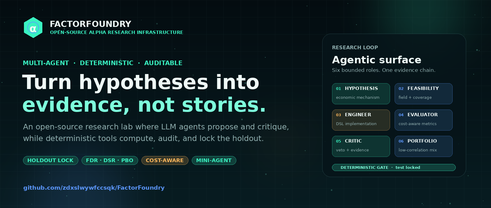
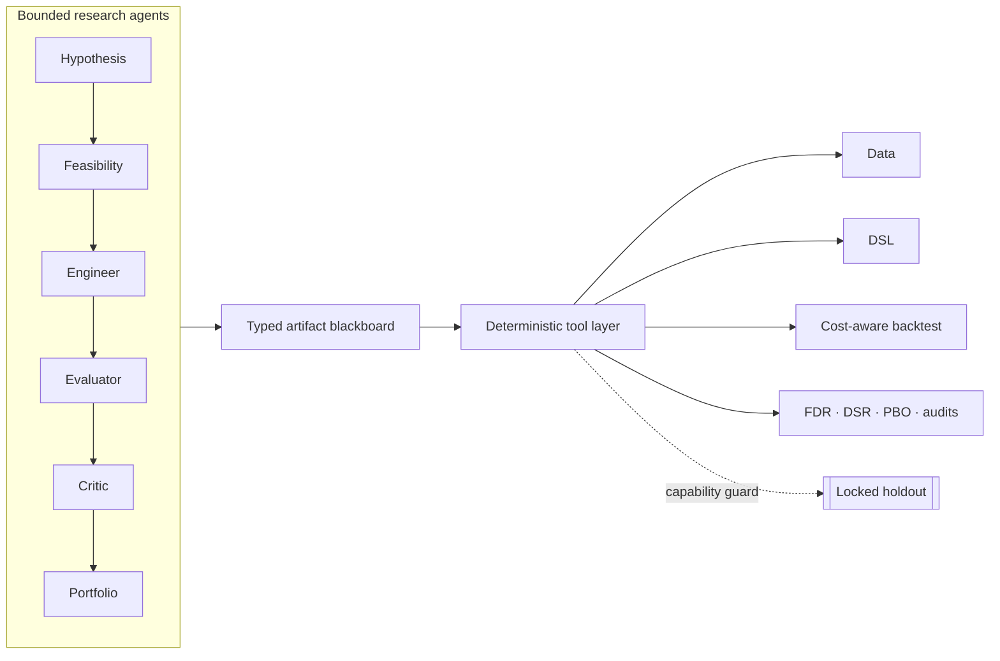

<div align="center">
  
</div>

<h1 align="center">FactorFoundry</h1>

<p align="center">
  <strong>The open-source research lab for alpha discovery.</strong><br>
  Agents propose. Deterministic tools compute, audit, and decide.
</p>

<p align="center">
  <a href="https://github.com/zdxslwywfccsqk/FactorFoundry/actions/workflows/ci.yml"></a>
  <a href="https://github.com/zdxslwywfccsqk/FactorFoundry/releases"></a>
  
  <a href="LICENSE"></a>
  
</p>

<p align="center">
  <a href="#quickstart">Quickstart</a> ·
  <a href="#why-factorfoundry">Why FactorFoundry</a> ·
  <a href="#reference-run">Reference run</a> ·
  <a href="#architecture">Architecture</a> ·
  <a href="ROADMAP.md">Roadmap</a> ·
  <a href="README.zh-CN.md">简体中文</a>
</p>

> [!IMPORTANT]
> FactorFoundry is research infrastructure, not investment advice or a live
> trading system. The reference run is a reproducible benchmark, not proof of a
> deployable alpha.

## Why FactorFoundry

Most factor-mining demos optimize for a prettier equity curve. FactorFoundry is
optimized for the probability that a result survives contact with reality.

> **The core bet:** language models are useful for search, but dangerous as the
> source of numerical truth. Give them the first job. Take away the second.

The repository is built around a different contract from a conventional
backtesting library:

| Conventional factor demo | FactorFoundry |
|---|---|
| The model writes code, metrics, and conclusions | Agents submit typed artifacts; deterministic tools compute every number |
| The test set is protected by convention | The test split is blocked by a runtime capability guard |
| Failed trials disappear into notebooks | Rejections remain first-class evidence with lineage |
| A high Sharpe is the end of the story | FDR, DSR, PBO, bootstrap intervals, and leakage audits are mandatory |
| Free-form multi-agent chat | Six bounded roles with explicit tool allowlists |
| One opaque pipeline | Append-only artifacts, SQLite ledger, JSONL event stream |

This is the project for researchers and engineers who want agentic search without
giving up reproducibility, negative evidence, or scientific skepticism.

## One loop, six bounded roles

```text
Hypothesis → Feasibility → Factor Engineer → Cost-aware Evaluator
      ↑                                                ↓
      └──── research memory     Adversarial Critic ←───┘
                                          ↓
                                  Portfolio Agent
                                          ↓
                               locked holdout release
```

| Role | Responsibility | Hard boundary |
|---|---|---|
| **Hypothesis** | Turn an economic mechanism into a testable card | Cannot run backtests |
| **Feasibility** | Check fields, coverage, and implementability | Cannot inspect returns |
| **Engineer** | Express the idea in the deterministic DSL | Cannot change the protocol |
| **Evaluator** | Run train/validation, cost-aware evaluation | Cannot access test |
| **Critic** | Inspect evidence and add vetoes | Cannot accept a factor that failed the gates |
| **Portfolio** | Combine accepted, low-correlation factors | Cannot use holdout performance |

Mini-Agent supplies the single-agent execution loop. FactorFoundry supplies the
multi-agent state machine, artifact blackboard, split guard, and deterministic
truth layer. See [`docs/AGENT_PROTOCOL.md`](docs/AGENT_PROTOCOL.md).

## Evidence by construction

Every run produces a self-contained evidence bundle:

- typed artifacts with producer, parents, content hash, schema version, split,
  and payload;
- an append-only event ledger for agent tasks, tool calls, failures, and split
  access;
- a manifest with config hash and data fingerprint;
- explicit holdout release records;
- both accepted and rejected candidates;
- a human-readable report and machine-readable summary.

The held-out test period is not a flag that a prompt politely avoids. It is a
runtime capability. The default command cannot evaluate it.

## Reference run

The v0.2 deterministic runtime reproduces the original A-share research result:

| Holdout net Sharpe | Holdout net annual return | Candidates | Critic accepted | Artifacts |
|---:|---:|---:|---:|---:|
| **0.7500** | **18.96%** | **73** | **2** | **374** |

**We publish the evidence that weakens our own headline.** The same run showed a
PBO of `0.51`, a Deflated Sharpe of `0.13`, an FDR q-value of `0.19`, a wide
bootstrap interval, and a short leg that is difficult to implement in A-shares.
Those are not footnotes; they are the point.

Read the full run, assumptions, and limitations in
[`docs/REFERENCE_RUN.md`](docs/REFERENCE_RUN.md) and
[`docs/BENCHMARK_PROTOCOL.md`](docs/BENCHMARK_PROTOCOL.md).

## Quickstart

Requirements: Python 3.10+ and access to the configured A-share data source. The
first run fetches data locally; it is never redistributed by this repository.

```bash
git clone https://github.com/zdxslwywfccsqk/FactorFoundry.git
cd FactorFoundry
python3 -m pip install -e .
make agentic
```

That command runs the complete artifact protocol without a model API call. It is
the reference path for CI and offline reproduction.

To run the tests with development dependencies:

```bash
python3 -m pip install -e '.[dev]'
make test
```

To evaluate the locked holdout after a frozen portfolio is selected:

```bash
make agentic-holdout
```

The release is recorded in `holdout_unlock.json` and the event ledger. Review the
benchmark protocol before using the resulting number externally.

<details>
<summary><strong>Wire an LLM into the research loop</strong></summary>

Install the optional Mini-Agent runtime:

```bash
python3 -m pip install -e '.[mini-agent]'
export FACTORFOUNDRY_API_KEY='...'
```

Enable the model in `config.json`, then run:

```bash
make agentic-mini
```

The agent roles share the same deterministic tools, artifacts, split guard, and
critic gates as the offline path. If the model runtime is unavailable, the
orchestrator can fall back while recording that fallback in the manifest.

See [`docs/ARCHITECTURE.md`](docs/ARCHITECTURE.md) for the adapter boundary and
[`SECURITY.md`](SECURITY.md) for the threat model.

</details>

## Architecture



Agents never pass mutable Python objects into the numerical core. They submit
artifacts. The orchestrator enforces legal transitions, and every tool call is
recorded. The design separates:

- **generation and judgment** — agent roles;
- **computation and acceptance** — deterministic tools and statistical gates;
- **coordination** — a state machine over a shared blackboard;
- **evidence** — append-only artifacts, events, and manifests.

## Repository map

<details>
<summary>Explore the code layout</summary>

```text
src/alpha_foundry/
  agentic/                 # state machine, roles, tools, blackboard, split guard
  data.py                  # market-data panel construction
  dsl.py                   # cross-sectional and time-series operators
  factors.py               # economic factor template library
  backtest.py              # cost-aware evaluation
  stats.py                 # FDR, DSR, PBO, leakage audits
  portfolio.py             # low-correlation signal combination
  pipeline.py              # legacy fixed-sequence pipeline
scripts/                   # data, diagnostics, tearsheets, brand assets
tests/                     # offline, protocol, artifact, and adapter tests
docs/                      # architecture, agent protocol, benchmark, launch kit
```

</details>

## What this project does not claim

- No market data is redistributed.
- No live trading or broker integration.
- No arbitrary agent-authored shell or Python execution in the default runtime.
- No free-for-all multi-agent chat room.
- No claim that one historical run proves a durable, implementable alpha.
- No claim that the reference long-short portfolio is directly executable in
  A-shares.

## Roadmap

The next public milestones are tracked in [`ROADMAP.md`](ROADMAP.md):

- point-in-time universe construction and delisting-aware evaluation;
- capacity, market-impact, and long-only implementation modes;
- reproducible benchmark leaderboard across factor families;
- controlled evaluation of LLM-generated hypotheses versus template search;
- cross-market adapters and external benchmark submissions.

## Contributing

Contributions that improve scientific honesty or reproducibility are especially
welcome:

- add a benchmark run with a fixed config and data fingerprint;
- propose an economic mechanism with a falsifiable prediction;
- stress-test the cost, capacity, or survivorship assumptions;
- add a regression test for a role boundary or split guard;
- improve the evidence report or the Mini-Agent adapter.

Start with [`CONTRIBUTING.md`](CONTRIBUTING.md), open a research proposal issue,
or join an existing discussion. If this direction is useful to you, **star the
repository and share the benchmark** — visibility is how a public, evidence-first
quant project attracts more reviewers and better data.

## Citation and license

- Code: [MIT](LICENSE)
- Citation metadata: [`CITATION.cff`](CITATION.cff)
- Community standard: [`CODE_OF_CONDUCT.md`](CODE_OF_CONDUCT.md)
- Release history: [`CHANGELOG.md`](CHANGELOG.md)
- Third-party notices: [`THIRD_PARTY_NOTICES.md`](THIRD_PARTY_NOTICES.md)
- Launch kit: [`docs/LAUNCH_KIT.md`](docs/LAUNCH_KIT.md)

If you use FactorFoundry in academic work, cite the repository and the exact run
id, config hash, and data fingerprint behind any reported result.
