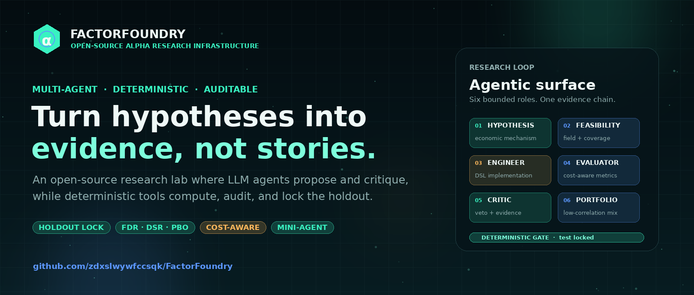
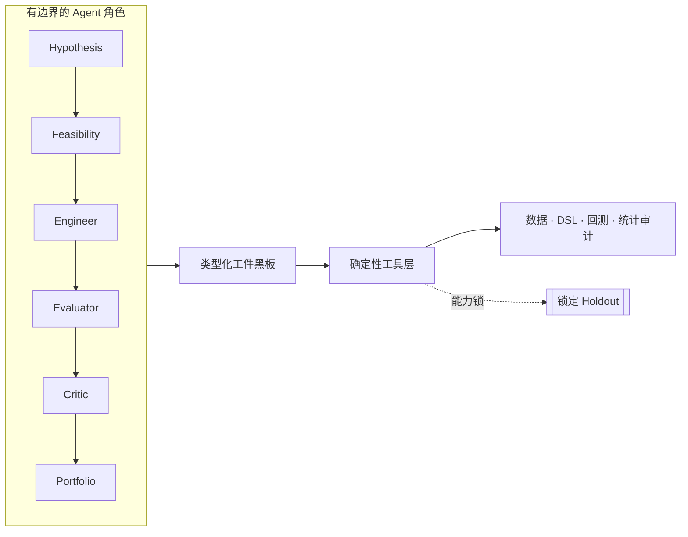

<div align="center">
  
</div>

<h1 align="center">FactorFoundry</h1>

<p align="center">
  <strong>面向 Alpha 挖掘的开源多智能体研究实验室。</strong><br>
  Agent 负责提出与质疑，确定性工具负责计算、审计和裁决。
</p>

<p align="center">
  <a href="README.md">English</a> ·
  <a href="#快速开始">快速开始</a> ·
  <a href="#参考运行">参考运行</a> ·
  <a href="docs/SCORECARD.md">判分标准</a> ·
  <a href="#系统架构">系统架构</a> ·
  <a href="ROADMAP.md">路线图</a>
</p>

> [!IMPORTANT]
> 本项目是研究基础设施，不是投资建议，也不是实盘交易系统。参考运行是可复现
> benchmark，不构成可部署 Alpha 的证明。

## 项目定位

很多因子挖掘项目在追求更漂亮的净值曲线。FactorFoundry 追求的是另一件事：
**一个结果在接触真实世界后仍然存活的概率。**

> **核心判断：** LLM 适合扩大搜索空间，但不适合成为数值真相的来源。前者交给
> Agent，后者必须交给确定性代码。

项目的设计契约与普通回测框架不同：

| 普通因子 Demo | FactorFoundry |
|---|---|
| 模型写代码、算指标、下结论 | Agent 只提交类型化工件，所有数字由确定性工具计算 |
| 测试集靠约定保护 | 测试区间由运行时能力锁保护 |
| 失败试验消失在 notebook | 被拒绝的因子也是带血缘的一等证据 |
| 高 Sharpe 就是终点 | 必须同时报告 FDR、DSR、PBO、Bootstrap 和泄漏审计 |
| 自由发挥的多 Agent 群聊 | 6 个边界明确的角色，每个角色有独立工具白名单 |
| 不透明的流水线 | Append-only 工件、SQLite 账本和 JSONL 事件流 |

## 一个闭环，六个角色

```text
经济假设 → 可行性检查 → 受限 DSL 实现 → 成本后回测
    ↑                                         ↓
    └──── 研究记忆    对抗式 Critic ←─────────┘
                              ↓
                         组合构建
                              ↓
                      锁定 Holdout 释放
```

| 角色 | 职责 | 硬边界 |
|---|---|---|
| **Hypothesis** | 把经济机制转成可检验假设 | 不能运行回测 |
| **Feasibility** | 检查字段、覆盖率和可实现性 | 不能查看收益 |
| **Engineer** | 用确定性 DSL 表达因子 | 不能修改评测协议 |
| **Evaluator** | 执行训练集/验证集成本后回测 | 不能访问测试集 |
| **Critic** | 审查证据并提出否决 | 不能接受未过门槛的因子 |
| **Portfolio** | 组合低相关且被接受的因子 | 不能使用 Holdout 表现 |

Mini-Agent 提供单 Agent 执行循环；FactorFoundry 提供多 Agent 状态机、工件黑板、
分区间锁和确定性真值层。

## 参考运行

| 证据评分 | Holdout 净 Sharpe | Holdout 年化净收益 | 候选因子 | Critic 接受 | 工件数 |
|---:|---:|---:|---:|---:|---:|
| **46 / 100 · D** | **0.7567** | **20.46%** | **73** | **0** | **375** |

**我们也公开会削弱这个标题结论的证据。** 同一次运行的 PBO 为 `0.56`，DSR 为
`0.25`，FDR q 值为 `0.33`，Holdout Sharpe 的 95% 区间为 `[-0.09, 0.32]`。
没有任何因子通过全部 Critic 门槛，因此页面中的组合是显式的 fallback。它是
benchmark，不是被接受的 Alpha。

完整结果、限制与复现实验见
[`docs/REFERENCE_RUN.md`](docs/REFERENCE_RUN.md)。

### Alpha 如何判分

FactorFoundry 不把 Sharpe 当成排行榜总分。每次运行都会经过
[`Alpha Evidence Scorecard`](docs/SCORECARD.md)：7 个 fail-closed 硬门槛、
100 分证据评分，以及独立的 `Alpha Candidate` 认证。收益再高，只要执行、成本、
泄漏控制、DSR 或 PBO 不达标，就只能标记为 `Benchmark only`，不能称为 Alpha。

```bash
factorfoundry-agent score <run_id> --format markdown
```

回测框架审计见 [`docs/BACKTEST_AUDIT.md`](docs/BACKTEST_AUDIT.md)。

## 快速开始

环境要求：Python 3.10+，并能访问配置中的 A 股数据源。首次运行会在本地下载行情，
仓库不分发市场数据。

```bash
git clone https://github.com/zdxslwywfccsqk/FactorFoundry.git
cd FactorFoundry
python3 -m pip install -e .
make agentic
```

该命令不需要任何模型 API，就能运行完整工件协议，适合 CI 和离线复现。

```bash
python3 -m pip install -e '.[dev]'
make test
```

在组合冻结后显式释放 Holdout：

```bash
make agentic-holdout
```

释放记录会写入 `holdout_unlock.json` 和事件账本。

## 系统架构



Agent 不向数值核心传递可变 Python 对象或自由文本结论。每个工件都记录生产者、
父节点、内容哈希、schema 版本、数据区间和 payload。详见
[`docs/ARCHITECTURE.md`](docs/ARCHITECTURE.md) 与
[`docs/AGENT_PROTOCOL.md`](docs/AGENT_PROTOCOL.md)。

## 参与贡献

尤其欢迎以下方向：

- 提交带固定配置和数据指纹的 benchmark；
- 提出有可证伪预测的新经济机制；
- 压力测试成本、容量、幸存者偏差等假设；
- 为角色边界或分区间锁增加回归测试；
- 改进证据报告、可视化或 Mini-Agent 适配器。

从 [`CONTRIBUTING.md`](CONTRIBUTING.md) 开始，或者提交一个 research proposal
issue。如果这个方向对你有价值，欢迎 **Star 并分享 benchmark**。公开项目的可见度，
决定了它能吸引多少审稿人、数据源和更好的研究问题。

## 引用与许可

- 代码许可：[MIT](LICENSE)
- 引用信息：[`CITATION.cff`](CITATION.cff)
- 发布记录：[`CHANGELOG.md`](CHANGELOG.md)
- 第三方声明：[`THIRD_PARTY_NOTICES.md`](THIRD_PARTY_NOTICES.md)
- 发布素材：[`docs/LAUNCH_KIT.md`](docs/LAUNCH_KIT.md)

引用任何结果时，请同时给出 run id、config hash 和 data fingerprint。
